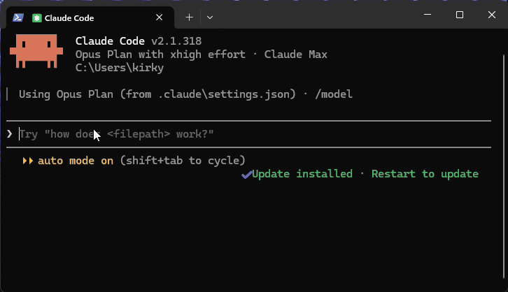

<p align="center">
  
  
</p>

**Python MCP servers that are read-only until you say otherwise.** One command gives you a working server on the official MCP Python SDK v2, with guardrails that are tested and on by default.

[](https://github.com/kclarkedesign/sett-mcp/actions/workflows/test-template.yml)
[](https://pypi.org/project/sett-mcp/)
[](https://glama.ai/mcp/servers/kclarkedesign/sett-mcp)

```bash
uvx sett-mcp new my-server
```

*A sett is a badger's den, dug deep and hard to break into. Setts are also the square stones that pave a solid road.*

<p align="center">
  
</p>
<p align="center"><sub>The example server in Claude Code: email and phone come back masked, and a delete waits for your answer.</sub></p>

## Why

Connecting an AI assistant to a real system is easy. Being comfortable leaving it connected is the hard part: what happens when the model decides to "clean up" some records? Most MCP starters give you a tool decorator and leave the rest to you. This one starts from the question your ops or security lead will ask.

## What you get

| Guardrail | How it works |
|---|---|
| **Write gate** | Write tools aren't registered unless `<PREFIX>_ENABLE_WRITES=true`. The model can't call what it can't see. The policy file can't flip this; only whoever runs the server can. |
| **Confirmations** | Destructive tools ask the user first ("Permanently delete contact c001?"), using multi-round-trip requests on the 2026-07-28 protocol and elicitation on older ones. Clients that can't show a prompt are refused, not waved through. See [client support](#client-support). |
| **Allow / deny lists** | Tools the policy excludes are never registered. |
| **Field masking** | `email`, `phone` or any field you list becomes `[masked]` before results reach the model or the audit log. A write that passes `[masked]` back is refused, so the placeholder can't overwrite real data. |
| **Audit log** | One JSON line per call: tool, kind, outcome, duration, masked arguments. |
| **Tool hints** | Every tool is marked read-only or destructive so clients can warn users. |
| **Strict policy file** | Unknown keys fail at startup, so a typo can't silently turn masking off. |

Plus the plumbing that usually takes an afternoon:

- A runnable example (a small contacts store) you replace with your real API client
- `install-claude-desktop` command that writes the config for macOS, Windows and Linux
- Stdio by default, stateless Streamable HTTP with `serve --http`, tested against the edge cases that break real clients
- **Remote in one command:** `deploy vercel --auth supabase` hosts the server on your own Vercel account with Supabase for sign-in: a consent page, invite-only users, a writer role for write tools, confirmations that work across server instances, and an audit table. Remote mode also works with any OAuth provider on any host
- Setup instructions for Claude Desktop, Claude Code, Cursor, the MCP Inspector and Docker
- Tests that drive the server through a real MCP client on both protocol versions
- GitHub Actions for CI and PyPI publishing, so users can run `uvx your-server`
- A `Dockerfile`, `glama.json` and a publishing guide for PyPI, Glama, the awesome-mcp-servers list and the official MCP Registry
- A `CLAUDE.md` that keeps Claude Code from bypassing the guardrails when it adds tools, and shows it how to describe tools well

## Quick start

```bash
uvx sett-mcp new my-server
cd my-server
uv run --extra dev pytest                  # the guardrail test suite
uv run my-server install-claude-desktop    # then restart Claude Desktop
```

To host it for others, with sign-in, on your own Vercel and Supabase accounts:

```bash
uv run my-server deploy vercel --auth supabase --supabase-project <ref>
uv run my-server users add you@example.com --writer
```

Copier asks for a name, tool prefix and environment-variable prefix. Everything else is filled in.

Adding a tool looks like this:

```python
@guard.read(name="acme_list_invoices")
async def list_invoices(status: str = "open") -> list[dict]:
    """List invoices by status."""
    return await api.invoices(status=status)

@guard.write(name="acme_void_invoice", destructive=True,
             confirm_message="Void invoice {invoice_id}? This can't be undone.")
async def void_invoice(invoice_id: str) -> dict:
    """Void an invoice."""
    return await api.void(invoice_id)
```

## Client support

Tested in November 2026 with the example server this template generates:

| Client | Tools and masking | Confirmation prompts |
|---|---|---|
| Claude Code | ✅ | ✅ Shows an Accept / Decline prompt, including in auto mode |
| Claude on the web (claude.ai, remote connector) | ✅ | ✅ Shows a "requests your input" card with Submit / Decline. Tested against a server deployed with `deploy vercel --auth supabase` |
| Cursor | ✅ | ✅ Shows a Submit / Cancel prompt. Answer it promptly: Cursor gives up on a call that waits too long, then retries |
| Codex (desktop app; CLI 0.153 and 0.167) | ✅ | ⛔ Declines automatically without showing a prompt, so tools that need confirmation never run ([openai/codex#60158](https://github.com/openai/codex/issues/60158)) |
| Claude Desktop 4.x (Windows) | ✅ | ⛔ No prompt shown, so tools that need confirmation are refused and nothing changes |

What that means in practice:

- **A confirmation is only as strong as the client.** Sett can't tell a person clicking Accept from a client that accepts automatically. The write gate and the allow / deny lists don't depend on the client at all, so treat those as the hard limits.
- **In clients without prompts** (Codex and Claude Desktop today), keep the default `confirm: destructive`. Ordinary writes still work, and destructive ones are refused. Setting `confirm: off` makes them run without asking.
- **Claude may refuse on its own.** In our tests Claude sometimes declined to call a tool described as permanently deleting data, or asked in chat first. That's a welcome extra layer, but it depends on the model and the conversation, which is why the server enforces confirmation itself.

Tried another client? Open an issue with what you saw and we'll add it to the table.

## Keeping generated projects current

Guardrail fixes and SDK updates land here. Pull them into any project made from the template with:

```bash
uvx sett-mcp update
```

`sett-mcp` is a thin wrapper around [Copier](https://copier.readthedocs.io), so `uvx copier copy gh:kclarkedesign/sett-mcp my-server` and `copier update` work too.

## Migrating from FastMCP v1

SDK v2 renamed `FastMCP` to `MCPServer` and changed a dozen other things. See [docs/migrating-from-v1.md](docs/migrating-from-v1.md) for the checklist and how to move a hand-rolled write gate onto the guardrails.

## Roadmap

- A preflight `sett-mcp check` that tests a running server against real clients' quirks
- One-click `.mcpb` bundles for Claude Desktop
- More deploy targets: Cloudflare Workers, Cloud Run, Fly
- Example connectors, starting with a read-only Salesforce analyst server

## Contributing

Issues and pull requests are welcome. To work on the template itself:

```bash
uvx copier copy --trust --defaults --vcs-ref HEAD . /tmp/check
cd /tmp/check && uv run --extra dev pytest
```

## License

Apache-2.0. Projects you generate can choose Apache-2.0 or MIT. Logo and icon files are in `assets/`, including an animated reveal and a looping loading mark (rebuild them with `node scripts/build_motion.mjs`).
