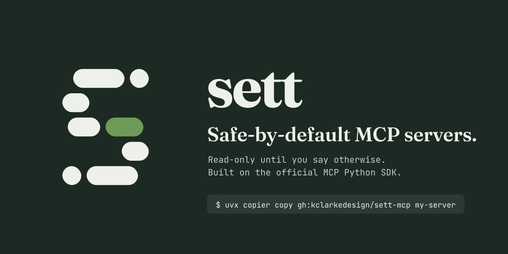

<p align="center"></p>

# sett-mcp

**Python MCP servers that are read-only until you say otherwise.** One command gives you a working server on the official MCP Python SDK v2, with guardrails that are tested and on by default: a write switch, confirmations for destructive tools, allow / deny lists, field masking and an audit log.

```bash
uvx sett-mcp new my-server
```

Later, pull template fixes into your project with `uvx sett-mcp update`.

Before sharing a deployed server (Sett's or any other), test it the way clients will:

```bash
uvx sett-mcp check https://my-server.vercel.app/mcp
```

This package is a small wrapper around [Copier](https://copier.readthedocs.io). The template, docs and client support notes are on GitHub: **[kclarkedesign/sett-mcp](https://github.com/kclarkedesign/sett-mcp)**.

Apache-2.0.
